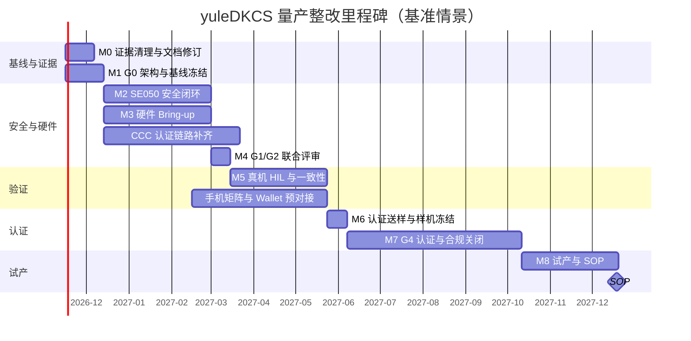

# yuleDKCS 量产整改计划

| 字段 | 内容 |
|---|---|
| 文档编号 | RMP-2026-001 |
| 关联评审 | PRR-2026-001 《yuleDKCS 量产可行性评审清单》 |
| 版本 | v1.2（追加软件可验证 P0 任务执行进展） |
| 状态 | 执行中 |
| 范围 | 对应 6 项 P0 阻断项与 G0–G5 量产门禁 |
| 制定日期 | 2026-11-08 |
| 工期基线 | 2026-11-16 启动；基准 57 周，SOP 基线 2027-12-19 |

---

## 0. 执行进展摘要（2026-11-08 更新）

> 本轮迭代完成全部**软件可验证 P0** 任务的软件回退/闭环实现，并通过 C 单元测试验证。硬件域（G1 Bring-up、G4 认证、G5 试产）不在本沙箱可执行范围，保持待办。

### 已完成（软件可验证部分）

| 任务 | 完成内容 | 证据 |
|---|---|---|
| **P0-06-T1~T3** 证据清理 | 旧 HIL 报告作废；RELEASE_NOTES/README 口径更正；新增《测试证据管理规范》TES-2026-001 | `docs/hil/HIL-TEST-RESULTS.md`（VOID 声明）、`docs/test-evidence-spec.md` |
| **P0-01-T1~T3** 固件可构建 | 重写 firmware CMake（双模式 host-sim / 真实 target）；创建 host HAL 桩；修复 main.c 未定义符号；补全 ICCE GATT 常量 | `cmake --build /tmp/fwbuild` 生成 `yuleDKCS_fw.elf`，无未定义符号 |
| **P0-02-T1** BSW 外部依赖 | 去除 `$HOME` 硬编码路径；`YULEASR_ROOT`/`YULEDKCS_ROOT` 可配置；缺失 yuleASR 时受控降级（仅构建 mcal_stubs/rtd_adapter/memif/test） | `cmake -S embedded/bsw_integration -B build` 配置成功，`test_rtd_adapter` 运行通过 |
| **P0-04-T2~T4** SE050 软件回退 | `sec_sign`/`sec_verify`/`sec_attestation`/`sec_verify_cert_chain` 软件实现（SM2 完整路径，USE_SE050 切换硬件） | `test_security_sw`：14/14 通过（签名/验签/证明/篡改检测/证书链） |
| **P0-03-T1~T2** CCC 认证状态机 | `STATE_AUTH_PROCESS` 闭环：验钥→证明→UWB→解锁/闭锁；`ccc_dk_set_auth_data` 接口；UWB 不可用降级解锁 | `test_ccc_auth`：11/11 通过（成功→UNLOCKED，签名/证明篡改→LOCKED） |
| **P0-05-T2（软件侧）** SE050 真机传输 | 新增 T=1' over I2C 传输层（NAD/PCB/LEN/CRC16、块链、R-block 重传），SCP03 默认走 T=1'；`SE050_USE_T1OI2C=0` 可回退 | `test_se050_t1oi2c`：15/15 通过（CRC 向量、简单/链式命令、链式响应、CRC 重试、缓存适配） |
| **G1 Bring-up（软件侧）** | 新增 7 项 `BRINGUP_SELFTEST` 自检固件（时间/存储/SE050/TRNG/BLE/NFC/UWB）；新增《G1 硬件 Bring-up 作业指导书》含可观测判据与证据要求 | `-DBRINGUP_SELFTEST=ON` 构建通过；host-sim 运行输出 PASS/FAIL/SKIP 正确；`docs/g1-bringup-runbook.md` |

### 待办（依赖硬件/认证）

P0-01-T4（CI 门禁）、P0-04-T1/T5~T8（SE050 真机/密钥层级/审计）、P0-03-T3~T6（UWB 真机/车辆接口/一致性）、P0-05-T1/T3~T8、G3/G4/G5 全部。P0-05-T2 软件侧已完成，真机验证按 G1-BR-2026-001 §3 执行。

---

## 1. 整改目标与范围

### 1.1 总体目标
将 yuleDKCS 从“云端可用、车端原型级”推进到**可通过 G4 认证审核、具备 G5 试产条件**的状态。整改完成的判定标准不是“代码写完”，而是：

1. 车端固件在干净环境一条命令可构建、可烧录、可签名校验；
2. ICCE / CCC / ICCOA 三协议在真实车端—手机—云端链路完成闭环；
3. SE050 安全链路真实生效，密钥不出芯片，通过第三方密码审计；
4. 硬件域 HIL 全部真机执行，证据可追溯；
5. 取得必需认证与 OEM 审核；
6. 试产直通率与早期失效率达到目标。

### 1.2 整改范围
- **必须整改（P0）**：固件可构建性、BSW 外部依赖、CCC 认证链路、SE050 安全闭环、硬件适配层、验证证据与认证/产线。
- **同步整改（P1）**：架构双固件合并、MISRA 真实修复、手机真机矩阵、云端渗透与生产密钥体系。
- **可选整改（P2）**：ASPICE CL2 过程证据、数据合规增强、量产看板自动化。

### 1.3 不在本次范围
- 商业模式、定价与市场推广；
- 整车其他 ECU 的功能开发；
- 新协议族引入（仅限 ICCE/CCC/ICCOA）。

---

## 2. 优先级与阶段划分

> 按依赖关系划分阶段，阶段之间串行，阶段内部任务可并行。本计划不设定具体工期，由项目经理在批准后补充排期。

| 阶段 | 名称 | 目标 | 关键门禁 |
|---|---|---|---|
| **P0 阶段** | 证据清理与基线冻结 | 恢复可信度，确定唯一量产基线 | G0 |
| **P1 阶段** | 安全闭环与可构建性 | 固件可构建，SE050 真实生效 | G2（与 G1 并行） |
| **P2 阶段** | 硬件 Bring-up | 真实 MCU/外设/无线链路可用 | G1 |
| **P3 阶段** | 真机 HIL 与协议一致性 | 端到端全场景通过 | G3 |
| **P4 阶段** | 认证与合规 | 取得证书与 OEM 审核 | G4 |
| **P5 阶段** | 试产与量产准备 | 小批量验证通过 | G5 |

依赖关系：P1 与 P2 可并行；P3 依赖 P1+P2；P4 与 P3 部分并行（认证样机）；P5 依赖 P4。

---

## 3. P0 阶段：证据清理与基线冻结

对应 P0-06（证据失真）与 G0 门禁。

| TaskID | 任务 | 负责角色 | 依赖 | 关键产出 | 验收标准 |
|---|---|---|---|---|---|
| P0-06-T1 | 作废旧 HIL 报告并发布说明 | 质量组 | — | 作废公告、归档记录 | 旧报告标记作废，评审结论引用新报告。**✅ 已完成** |
| P0-06-T2 | 修订版本说明与 README 状态口径 | 产品/市场组 | — | 修订后的 RELEASE_NOTES、README | 不再出现“生产就绪/92/100”等无依据表述。**✅ 已完成** |
| P0-06-T3 | 建立测试证据规范（时间戳/设备序列号/仪器原始数据/归档哈希） | 质量组 | — | 《测试证据管理规范》 | 规范经质量与客户代表签字。**✅ 已完成（TES-2026-001）** |
| G0-T1 | 冻结唯一量产固件架构（S32K312 主控 + KW47A 协处理器） | 架构组 | — | 架构决策记录 ADR | 双入口合并或归档，单一基线 |
| G0-T2 | 外部依赖入库并锁定版本（yuleASR、NXP SDK、SE050 中间件、FreeRTOS） | 嵌入式组 | G0-T1 | 子模块/制品库清单 | 干净环境可离线构建，无仓库外私有路径 |
| G0-T3 | 配置项与编译开关基线化 | 嵌入式组 | G0-T1 | 受控配置清单 | 构建产物可追溯至提交哈希与配置哈希 |
| G0-T4 | BOM、引脚、外设与硬件设计对齐评审 | 硬件组 | G0-T1 | 对齐评审记录 | 原理图、PCB、软件配置逐项签字一致 |

---

## 4. P1 阶段：安全闭环与可构建性

对应 P0-01（固件构建）、P0-02（BSW 依赖）、P0-03（CCC 认证）、P0-04（SE050 安全），以及 G2 门禁。

### 4.1 固件可构建性

| TaskID | 任务 | 负责角色 | 依赖 | 关键产出 | 验收标准 |
|---|---|---|---|---|---|
| P0-01-T1 | 修复 firmware/CMakeLists.txt 目标顺序（target_include_directories 移到 add_executable 之后） | 嵌入式组 | G0-T1 | 可配置的 CMake | `cmake -S embedded/firmware -B build` 配置成功。**✅ 已完成** |
| P0-01-T2 | 统一链接库名：target_link_libraries 使用 ccc_dk/icce_dk/iccoa_dk | 嵌入式组 | P0-01-T1 | 可链接固件 | 链接阶段无未定义符号。**✅ 已完成** |
| P0-01-T3 | 补齐板级初始化函数（kw47a_board_init / clock / storage / nfc_poll / ble_poll）或切换到 S32K312 基线 | 嵌入式组 | P0-01-T2 | 板级支持包 | 固件启动到主循环，无未定义引用。**✅ 已完成（host HAL 桩 + 真实 target 路径）** |
| P0-01-T4 | 将固件全量构建加入 CI 门禁 | DevOps | P0-01-T3 | CI 配置 | CI 失败即阻断合并 |
| P0-02-T1 | 移除 bsw_integration 中对 $HOME 私有路径的硬编码，改用子模块/制品 | 嵌入式组 | G0-T2 | 可复现 BSW 构建 | CI 完成 BSW 全量链接。**✅ 已完成（可配置路径 + 受控降级）** |

### 4.2 SE050 安全闭环

| TaskID | 任务 | 负责角色 | 依赖 | 关键产出 | 验收标准 |
|---|---|---|---|---|---|
| P0-04-T1 | 接入 SE050 Plug&Trust 中间件，建立真实 SCP03 会话 | 安全组 | P0-01-T3 | SCP03 握手实现 | 真机握手成功，会话密钥派生正确 |
| P0-04-T2 | 实现 sec_sign：经 SCP03 通道调用 SE050 ECDSA 硬件签名 | 安全组 | P0-04-T1 | 真实签名接口 | 输出 64 字节 r‖s，标准向量通过。**✅ 软件回退完成（SM2，USE_SE050 切换硬件）** |
| P0-04-T3 | 实现 sec_verify：加载公钥、ECDSA 验签 | 安全组 | P0-04-T1 | 真实验签接口 | 正/负向向量通过。**✅ 软件回退完成** |
| P0-04-T4 | 实现 sec_attestation：设备 ID、固件哈希、证明签名、证书链验证 | 安全组 | P0-04-T1 | 证明接口 | 证明可被云端独立验真。**✅ 软件回退完成（含 sec_verify_cert_chain）** |
| P0-04-T5 | 密钥层级设计与产线注入流程 | 安全组 | P0-04-T1 | 密钥管理方案 | 根密钥→设备密钥层级清晰，支持吊销 |
| P0-04-T6 | 安全启动、调试口权限、回滚保护 | 安全组 | P0-04-T1 | 启动链安全方案 | 篡改固件无法启动，调试口受控 |
| P0-04-T7 | 国密 SM2/SM3/SM4 与 ECDSA 标准向量 + OpenSSL 交叉验证 | 安全组 | P0-04-T2/3 | 密码测试报告 | 全部标准向量通过 |
| P0-04-T8 | 第三方密码审计与渗透测试 | 安全组 | P0-04-T2~7 | 审计报告 | 无未修复高危 |

### 4.3 CCC 认证链路

| TaskID | 任务 | 负责角色 | 依赖 | 关键产出 | 验收标准 |
|---|---|---|---|---|---|
| P0-03-T1 | 设计 CCC 认证状态机（PAIRING / VERIFY_KEY / ATTESTATION / AUTH_DONE / FAILED） | 嵌入式组 | P0-04-T2~4 | 状态机设计文档 | 状态与转移经架构评审。**✅ 已实现（STATE_AUTH_PROCESS 闭环）** |
| P0-03-T2 | 在 STATE_AUTH_PROCESS 接入钥匙校验与证明验证 | 嵌入式组 | P0-03-T1, P0-04-T3/4 | 认证流程代码 | 认证失败闭锁，重放被拒。**✅ 已完成（验钥→证明→签名→UWB→解锁/闭锁）** |
| P0-03-T3 | 实现 UWB 会话建立与测距启动（基于真实 NCJ29D6） | 嵌入式组 | P2 阶段硬件驱动 | UWB 会话模块 | 测距精度达标 |
| P0-03-T4 | 实现解锁/闭锁/启动命令下发与车辆接口 | 嵌入式组 | P0-03-T2 | 车辆控制接口 | 真机解锁闭锁成功 |
| P0-03-T5 | 认证异常路径（超时、断连、低电量）进入安全状态 | 嵌入式组 | P0-03-T2 | 失效安全逻辑 | 异常时保持闭锁 |
| P0-03-T6 | CCC 一致性测试用例对齐 | 嵌入式组 | P0-03-T2~5 | 一致性测试报告 | 认证机构用例通过 |

---

## 5. P2 阶段：硬件 Bring-up

对应 P0-05（硬件桩）与 G1 门禁。

| TaskID | 任务 | 负责角色 | 依赖 | 关键产出 | 验收标准 |
|---|---|---|---|---|---|
| P0-05-T1 | 引入 NXP RTD / MCUXpresso SDK，替换 MCAL 桩代码 | 硬件组 | G0-T2 | 真实 MCAL | MCU 时钟/电源/看门狗/存储验证通过 |
| P0-05-T2 | 集成 SE050 Plug&Trust 驱动 | 硬件组 | P0-05-T1 | SE050 驱动 | 芯片初始化与 APDU 通信正常。**🔶 软件侧就绪：T=1' 传输层 + 模拟卡单测 15/15；真机验证见 G1-BR-2026-001 §3** |
| P0-05-T3 | 集成 NCJ29D6 UWB 厂商驱动 | 硬件组 | P0-05-T1 | UWB 驱动 | 测距初始化、IRQ、数据读取正常 |
| P0-05-T4 | 集成 ST25R501 NFC 厂商驱动 | 硬件组 | P0-05-T1 | NFC 驱动 | 场检测与 OOB 交换正常 |
| P0-05-T5 | 集成 KW47A BLE 驱动 | 硬件组 | P0-05-T1 | BLE 驱动 | 连接、配对、吞吐达标 |
| P0-05-T6 | 天线匹配与射频功率调试 | 射频组 | P0-05-T3/4/5 | 射频报告 | 发射功率、谐波、灵敏度达标 |
| P0-05-T7 | 功耗与低功耗唤醒验证 | 硬件组 | P0-05-T1 | 功耗报告 | 暗电流、续航达标，唤醒源全部通过 |
| P0-05-T8 | EMC/ESD 预测试 | 硬件组 | P0-05-T6 | EMC 预测试报告 | 满足整车预测试要求 |

---

## 6. P3 阶段：真机 HIL 与协议一致性

对应 G3 门禁。

| TaskID | 任务 | 负责角色 | 依赖 | 关键产出 | 验收标准 |
|---|---|---|---|---|---|
| G3-T1 | 37 项硬件域 HIL 用例全部在真实 EVB 执行 | 测试组 | P1+P2 | HIL 报告（新） | 无 SKIP，含时间戳与仪器原始数据 |
| G3-T2 | ICCE 协议一致性测试 | 嵌入式组 | G3-T1 | ICCE 测试报告 | 标准用例 + 异常/重放/降级通过 |
| G3-T3 | CCC 协议一致性测试 | 嵌入式组 | P0-03 | CCC 测试报告 | 认证机构用例通过 |
| G3-T4 | ICCOA 协议一致性测试 | 嵌入式组 | G3-T1 | ICCOA 测试报告 | 标准用例通过 |
| G3-T5 | 手机真机兼容矩阵（Android/iOS 主流机型） | 移动端组 | G3-T1 | 兼容矩阵 | 覆盖主流机型与系统版本，含 Wallet 与后台限制场景 |
| G3-T6 | 全场景端到端（解锁/闭锁/启动/分享/撤销/多钥匙冲突） | 测试组 | G3-T2~5 | 端到端报告 | 全部通过 |
| G3-T7 | 失效安全场景（断电/断连/低电量/信号干扰/SE 失效） | 测试组 | G3-T6 | 失效安全报告 | 均进入安全状态 |

---

## 7. P4 阶段：认证与合规

对应 G4 门禁。

| TaskID | 任务 | 负责角色 | 依赖 | 关键产出 | 验收标准 |
|---|---|---|---|---|---|
| G4-T1 | ICCE 国密与协议认证 | 认证组 | G3-T2 | 认证证书 | 证书在有效期内，覆盖量产型号 |
| G4-T2 | CCC Digital Key 认证 | 认证组 | G3-T3 | 认证证书 | 取得 CCC 证书与测试报告 |
| G4-T3 | ICCOA 认证 | 认证组 | G3-T4 | 认证证书 | 取得 ICCOA 认证 |
| G4-T4 | Apple / Google Wallet 接入 | 移动端组 + 认证组 | G3-T5 | Wallet 上线许可 | TSP 对接完成，OEM 审核通过 |
| G4-T5 | ISO 21434 TARA、ISO 26262 安全活动、ASPICE CL2 证据 | 质量组 | 全阶段 | 过程证据包 | 可追溯，审核关闭 |
| G4-T6 | OEM 信息安全与功能安全审核 | 安全组 | G4-T5 | 审核关闭记录 | 无未关闭项 |

---

## 8. P5 阶段：试产与量产准备

对应 G5 门禁。

| TaskID | 任务 | 负责角色 | 依赖 | 关键产出 | 验收标准 |
|---|---|---|---|---|---|
| G5-T1 | OTA 升级、回滚、断电保护真机验证 | 嵌入式组 | G1/G2 | OTA 验证报告 | 差分/整包、双分区、回滚、断电续传通过 |
| G5-T2 | EOL 测试规范与工装 | 工艺组 | G3-T1 | EOL 规范 + 工装 | 烧录/校验/射频自检/标识写入全流程实跑 |
| G5-T3 | MES 与批次追溯打通 | 工艺组 + 云端组 | G5-T2 | MES 对接报告 | 设备 ID、密钥批次、烧录记录全链路可追溯 |
| G5-T4 | PPAP / APQP 文件齐套 | 质量组 | G3 | PPAP 包 | DFMEA、PFMEA、控制计划、MSA、过程能力、首件批准完成 |
| G5-T5 | 供应链双源与器件生命周期确认 | 供应链组 | G0-T4 | 供应链报告 | 关键器件双源或安全库存，交期满足节拍 |
| G5-T6 | 小批量试装与早期失效验证 | 工艺组 | G5-T2~5 | 试产报告 | 直通率、早期失效率、ESS 结果达标 |

---

## 9. 资源需求

### 9.1 人力资源
| 角色 | 主要职责 | 建议配置 |
|---|---|---|
| 架构组 | 架构决策、协议设计、接口定义 | 1 名 |
| 嵌入式组 | 协议栈、驱动、安全、OTA | 3–4 名 |
| 硬件组 | MCU/外设驱动、Bring-up、功耗 | 2 名 |
| 射频组 | 天线、射频功率、EMC | 1 名 |
| 安全组 | SE050、密码、启动链、审计 | 2 名 |
| 云端组 | 服务、batch-api、渗透整改 | 2 名 |
| 移动端组 | SDK、Wallet、真机矩阵 | 2 名 |
| 测试组 | HIL、一致性、端到端、失效安全 | 2 名 |
| 质量组 | 证据、MISRA、ASPICE、PPAP | 1–2 名 |
| 认证组 | ICCE/CCC/ICCOA/Wallet | 1 名 |
| 工艺组 | EOL、MES、试产 | 1–2 名 |
| DevOps | CI/CD、构建、发布 | 1 名 |

### 9.2 工具与设备
- 硬件：S32K312-EVB、KW47A 模组、NCJ29D6、ST25R501、SE050 开发板、J-Link、逻辑分析仪、示波器、频谱仪、电流探头、屏蔽箱。
- 软件：NXP RTD / MCUXpresso SDK、SE050 Plug&Trust 中间件、NCJ29D6 与 ST25R501 厂商驱动、MISRA 静态分析工具、密码审计工具、CI 资源。
- 认证：ICCE/CCC/ICCOA 认证机构席位、Apple/Google Wallet 合作名额、EMC/射频实验室。

### 9.3 关键依赖
- NXP 厂商 SDK 与中间件获取；
- SE050、NCJ29D6、ST25R501 供应商支持；
- 认证机构排期；
- OEM TSP 与安全审核窗口。

---

## 10. 风险与缓解

| 风险 | 等级 | 缓解措施 |
|---|---|---|
| CCC 协议栈缺口大，认证样机延期 | 严重 | 优先补齐或引入经认证栈；认证样机独立里程碑 |
| 安全实现自研密码存在隐患 | 严重 | 强制 SE050 硬件密码；第三方审计前置 |
| 外部依赖与供应链延迟 | 高 | 双源策略、安全库存、版本锁定 |
| 认证排期不可控 | 高 | 提前锁定实验室与 TSP，认证与开发并行 |
| 硬件射频/功耗不达标 | 高 | EVB 阶段预留整改窗口，射频组提前介入 |
| 证据再次失真影响信任 | 高 | 证据规范强制执行，独立复核 |
| 手机兼容问题暴露晚 | 中高 | 真机矩阵前置到 G3，持续回归 |

---

## 11. 质量与验收流程

### 11.1 任务级验收
- 每个 TaskID 完成后由责任角色提交产出物；
- 验收标准逐条核对，由质量组 + 架构组复核；
- 复核通过后任务状态置为“已完成”，否则退回并记录原因。

### 11.2 阶段门禁验收
- P0~P5 各阶段结束时，对照 G0~G5 门禁清单逐项确认；
- 门禁清单全部勾选 + 产出物归档 + 评审签字，方可进入下一阶段；
- 任何 P0 阻断项未关闭，评审结论维持 NO-GO。

### 11.3 整改跟踪机制
- 建立任务看板（TaskID / 负责人 / 状态 / 依赖 / 产出物 / 风险）；
- 每周例行同步阻塞项与风险；
- 每次评审更新本计划版本与变更记录。

---

## 12. 放行判定

量产放行需同时满足：

1. G0–G5 门禁清单全部勾选关闭；
2. 6 项 P0 阻断项全部关闭并有可复现证据；
3. 认证证书与 OEM 审核全部取得；
4. 小批量试产直通率与早期失效率达标；
5. 评审负责人、质量、安全、客户代表四方签字。

未满足上述任一条件，不得进入 SOP。

---

## 13. 里程碑计划

### 13.1 基线里程碑

> 基线起点：2026-11-16（周一）。下表为**基准情景**，不含 6 周管理储备。里程碑完成以退出标准全部满足为准，不以“时间到点”自动通过。

| 里程碑 | 名称 | 负责角色 | 关键交付 | 基线完成 | 工期 |
|---|---|---|---|---|---|
| **M0** | 整改启动与证据清理 | 质量组 / 产品组 | 旧 HIL 报告作废、版本口径修订、测试证据规范 | 2026-12-06 | 3 周（W1–W3） |
| **M1** | G0 架构与基线冻结 | 架构组 / 嵌入式组 | 单一固件架构、依赖入库、可复现构建、BOM 对齐 | 2026-12-13 | 4 周（W1–W4，与 M0 并行） |
| **M2** | G2 安全闭环 | 安全组 | SCP03、签名/验签/证明、安全启动、密钥注入、密码审计 | 2027-02-28 | 11 周（W5–W15） |
| **M3** | G1 硬件 Bring-up | 硬件组 / 射频组 | 真实 MCAL/驱动、射频、功耗、EMC 预测试 | 2027-02-28 | 11 周（W5–W15） |
| **M4** | G1/G2 联合门禁评审 | 质量组 / 架构组 | 门禁证据包、问题关闭记录、评审签字 | 2027-03-14 | 2 周（W16–W17） |
| **M5** | G3 真机 HIL 与一致性 | 测试组 / 嵌入式组 | 37 项 HIL、三协议一致性、手机矩阵、端到端、失效安全 | 2027-05-23 | 10 周（W18–W27） |
| **M6** | 认证送样与样机冻结 | 认证组 / 质量组 | 认证样机、测试申请受理、TSP/Wallet 材料 | 2027-06-06 | 2 周（W28–W29） |
| **M7** | G4 认证与合规关闭 | 认证组 / 安全组 | ICCE/CCC/ICCOA 证书、Wallet、OEM 审核、ASPICE | 2027-10-10 | 18 周（W30–W47） |
| **M8** | G5 试产与 SOP | 工艺组 / 质量组 | PPAP、EOL/MES、试产报告、SOP 放行 | 2027-12-19 | 10 周（W48–W57） |

### 13.2 里程碑退出标准

- **M0**：旧 HIL 报告已标记作废并归档；对外文档不再出现“生产就绪”表述；证据规范经质量与客户代表签字。
- **M1**：唯一量产固件架构生效；干净环境一条命令构建成功；外部依赖全部入库并锁定版本；BOM/引脚/配置评审通过。
- **M2**：SE050 SCP03 真实会话建立；签名、验签、证明、证书链全部可用；密钥注入与安全启动验证通过；第三方密码审计无未修复高危。
- **M3**：MCAL 与四类外设驱动真实运行；BLE/NFC/UWB 链路实测达标；射频、功耗、EMC 预测试通过。
- **M4**：G1、G2 门禁清单全部关闭；无开放 P0；质量、安全、架构三方签字。
- **M5**：37 项硬件域 HIL 无 SKIP；ICCE/CCC/ICCOA 一致性通过；主流手机矩阵与 Wallet 预对接通过；全场景与失效安全通过。
- **M6**：认证样机版本冻结并完成哈希归档；认证机构正式受理；TSP/Wallet 材料提交。
- **M7**：三协议证书取得；Apple/Google Wallet 与 OEM 审核关闭；ISO 21434/26262 与 ASPICE CL2 证据通过。
- **M8**：PPAP/APQP 齐套；EOL/MES 实跑；试产直通率与早期失效率达标；四方签字放行。

### 13.3 基线甘特图



---

## 14. 工期估算

### 14.1 估算假设

1. 2026-11-16 启动，按 5 天工作周计算；
2. 各角色按第 9 节配置到位，关键角色不共享；
3. NXP SDK、SE050 中间件、UWB/NFC 厂商驱动在启动后 2 周内可获得；
4. 认证机构与 TSP/Wallet 窗口可预约，认证与开发部分并行；
5. 硬件不出现需要改版的重大问题；若改版，按第 16 节规则调整；
6. 估算为**工程量估算**，不是对外承诺日期；对外日期需经管理层批准并预留管理储备；
7. 基准按自然周排布，未单独扣除春节、国庆等法定节假日；若关键路径跨节假日，应顺延或使用管理储备。

### 14.2 分工作流估算

| 工作流 | 乐观（周） | 基准（周） | 悲观（周） | 说明 |
|---|---:|---:|---:|---|
| A 证据清理与文档修订 | 2 | 3 | 5 | 取决于历史证据核查范围 |
| B 架构冻结与可复现构建 | 3 | 4 | 6 | 双固件合并与外部依赖入库是主要变量 |
| C SE050 安全闭环 | 8 | 11 | 16 | 含 SCP03、签名/验签/证明、密钥注入、审计整改 |
| D 硬件 Bring-up | 9 | 11 | 18 | 悲观情景含一次硬件改版 |
| E CCC 认证链路补齐 | 10 | 14 | 20 | 若引入成熟协议栈可压缩，但需许可与集成 |
| F 真机 HIL 与一致性 | 8 | 10 | 14 | 依赖 C、D 完成 |
| G 手机矩阵与 Wallet | 10 | 14 | 22 | Wallet 受 TSP/OEM 排期影响 |
| H 认证与合规 | 14 | 18 | 26 | CCC 与 Wallet 是长周期项 |
| I 试产与 PPAP | 8 | 10 | 14 | 含 EOL、MES、试装与整改 |
| J 云端生产化与渗透整改 | 6 | 8 | 12 | 可并行，不在关键路径 |

### 14.3 总工期

| 情景 | 总工期 | 预计 SOP | 适用条件 |
|---|---:|---|---|
| 乐观 | 46 周（约 10.5 个月） | 2027-10-03 | 厂商资源即时到位、认证零排队、无硬件改版 |
| **基准** | **57 周（约 13 个月）** | **2027-12-19** | 按本计划假设，含 6 周门禁/试产缓冲 |
| 悲观 | 70 周（约 16 个月） | 2028-03-19 | 硬件改版或认证排队，关键路径顺延 |
| 极端 | 76 周（约 17.5 个月） | 2028-04-30 | 硬件改版与认证排队同时发生 |

> 基准 57 周由关键路径叠加：G0 4 周 + 安全闭环 11 周 + 真机 HIL 10 周 + 认证 18 周 + 试产净 8 周 + 门禁/试产缓冲 6 周。  
> 另设 **6 周管理储备**，不纳入对外承诺；仅在关键路径发生不可控延期时由管理层释放。

---

## 15. 关键路径与缓冲

### 15.1 关键路径

```text
M0/M1（基线冻结）
  → M2（SE050 安全闭环）
  → M4（G2 评审）
  → M5（真机 HIL 与一致性）
  → M6（认证送样）
  → M7（认证与合规）
  → M8（试产）
  → SOP
```

**次关键路径：**

- CCC 认证链路补齐：若超过 14 周，将直接推迟 M5 与 M7；
- 硬件 Bring-up：若出现改版，M3、M5、M7 依次顺延；
- 认证机构与 Wallet 排期：属于外部依赖，内部无法完全压缩；
- 手机真机矩阵：问题暴露越晚，认证阶段返工成本越高。

### 15.2 缓冲设置

| 缓冲 | 位置 | 基线归属 | 用途 |
|---|---|---|---|
| 2 周 | M4 门禁评审 | 已含在基线（M4 工期 2 周） | 吸收 G1/G2 问题关闭延迟 |
| 2 周 | M6 认证送样前 | 已含在基线（M6 工期 2 周） | 吸收样机与材料准备延迟 |
| 2 周 | M8 试产结束前 | 已含在基线（M8 工期 10 周内） | 吸收试产整改与复测 |
| 6 周 | 管理储备 | 基线外 | 仅用于关键路径不可控延期 |

### 15.3 可压缩路径

1. **认证前置**：在 M4 后立即启动 ICCE/ICCOA 预测试，CCC 完成认证链路后立即送样；认证与 HIL 并行。
2. **预合规测试**：W20 起使用认证机构预测试服务，提前发现射频、协议与安全差距。
3. **样机冗余**：准备 3 套认证样机，避免单套样机故障导致排队重来。
4. **成熟栈替代**：若 CCC 自研补齐预计超过 14 周，评估引入经认证的成熟协议栈。
5. **Wallet 前置**：W12 启动 TSP/Apple/Google 对接，不等认证完成再启动。
6. **硬件并行**：EVB Bring-up 与 PCB 优化并行，射频/功耗问题早发现早整改。

---

## 16. 排期风险与调整规则

### 16.1 触发条件与应对

| 触发条件 | 预计影响 | 应对措施 |
|---|---|---|
| 厂商 SDK/驱动延迟超过 2 周 | +2–4 周 | 升级供应商支持；先用 EVB 参考驱动；调整 M3 |
| CCC 链路补齐超过 14 周 | +4–6 周 | 评估许可成熟栈；增加临时人力；重排 M5/M7 |
| 认证机构排队超过 4 周 | +4 周 | 双实验室预约；预合规测试；提前锁定席位 |
| 硬件需要改版 | +6–8 周 | 设计评审前置；保留改版预算；M3/M5/M7 顺延 |
| SE050 交期或产能问题 | +3–6 周 | 提前采购；评估第二来源；安全方案预留替代 |
| 手机矩阵出现集中兼容问题 | +2–4 周 | 聚焦主流机型；厂商联合定位；分批放行 |
| 关键人员流失 | +2–4 周 | 双人维护；文档与交接；关键模块代码评审 |
| 客户需求变更 | 视变更而定 | 走变更控制委员会；重新基线化 |

### 16.2 排期调整规则

1. 关键路径任务偏差 **≥1 周**，项目经理必须在周例会上提出纠偏方案；
2. 关键路径累计偏差 **≥4 周**，触发计划重新基线化，更新里程碑与 SOP 预测；
3. 任何 P0 阻断项延期，不得通过压缩测试或认证周期来“追回”；
4. 管理储备的释放需管理层批准，并记录释放原因与剩余储备；
5. 每月向管理层与客户提交里程碑达成率、关键路径偏差与风险Top5。

---

## 附录：P0 到门禁的映射

| P0 阻断项 | 对应门禁 | 关键 TaskID |
|---|---|---|
| P0-01 固件不可构建 | G0 / G2 | P0-01-T1~T4 |
| P0-02 BSW 外部依赖 | G0 | P0-02-T1, G0-T2 |
| P0-03 CCC 认证链路 | G2 / G3 | P0-03-T1~T6 |
| P0-04 SE050 安全闭环 | G2 | P0-04-T1~T8 |
| P0-05 硬件适配层 | G1 | P0-05-T1~T8 |
| P0-06 证据失真 / 认证产线 | G0 / G3 / G4 / G5 | P0-06-T1~T3, G4, G5 |
